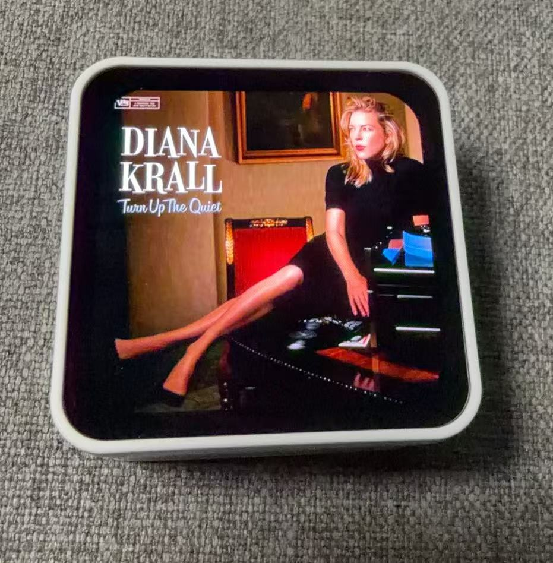
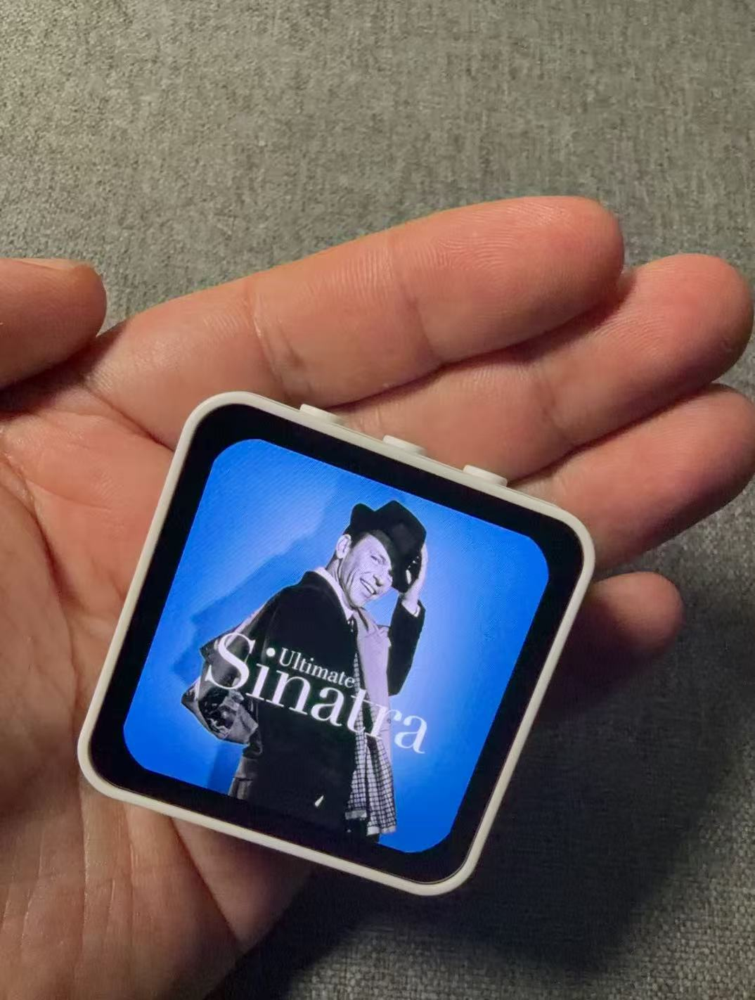

# CoverArt Mini 使用说明书

插上电、连上家里的 Wi-Fi、在 Roon 里启用一次，CoverArt Mini 就会自动显示你正在听的专辑封面，还能用触摸和翻面控制播放。设备出厂已装好软件，拿到手直接按第 3 节设置即可，全程约 3 分钟。

## 1. 产品概览

CoverArt Mini 是一块方形封面屏，跟随你在 Roon 中选定的一个 Zone，显示正在播放的专辑封面。它直接与家里的 Roon Core 通信，不需要电脑或手机 App 常驻。

机身只有半个手掌大，打开时屏幕几乎铺满整个正面。

| 项目 | 说明 |
| --- | --- |
| 屏幕 | 2.16 英寸 AMOLED，480 × 480 |
| 操作 | 触摸：单击、左右滑动；感应：屏幕扣下、拿起 |
| 供电 | USB-C；带电池的设备拔掉 USB 后用电池继续工作，插上即充电 |
| 网络 | 2.4 GHz Wi-Fi，不支持 5 GHz |
| 在 Roon 中的名称 | CoverArt Mini，发布者“门耳朵制作” |
| 软件版本 | 0.6.0，出厂已装好 |

设备顶部有三个按键，日常使用不需要按动。开机时请不要按住其中任何一个。

## 2. 开始之前

- 家里有一台正在运行的 Roon Core（Roon Server 或 Roon 桌面版均可）。
- 一个 2.4 GHz Wi-Fi，和 Roon Core 在同一个家庭网络里。
- 一部能扫描二维码的手机，用来设置 Wi-Fi。
- 一根 USB-C 线和一个常见的手机充电器。带电池的设备建议先插电充一会儿。

## 3. 首次设置

全程约 3 分钟：先让设备连上 Wi-Fi，再在 Roon 里启用它，并选好要跟随的 Zone。

### 3.1 连接 Wi-Fi

1. 插上 USB-C 供电。新设备会自动进入配网模式，屏幕显示 WI-FI SETUP、一个二维码和网络名 CoverArt-XXXXXX（后六位每台不同）。
2. 用手机相机扫描二维码，加入这个网络（不需要密码）。也可以在手机的 Wi-Fi 列表里直接点选它。
3. 手机会自动弹出设置页面（中英双语）。没有弹出时，用手机浏览器打开 `http://192.168.4.1`。
4. 从列表里选择家里的 Wi-Fi（也可以手动输入名称），输入密码，点“连接”。列表只显示 2.4 GHz 网络；名称和密码里有中文也能正常输入。
5. 等待约 20 秒：
    - 成功：屏幕显示 WI-FI OK / Restarting，设备自动重启，设置用的网络随之关闭，手机回到原来的网络。
    - 失败：屏幕重新显示二维码。再次加入设置网络，页面会提示“无法连接”，核对密码后重试。

### 3.2 在 Roon 中启用

1. 打开 Roon → 设置 → 扩展。
2. 找到 CoverArt Mini（发布者“门耳朵制作”），点“启用”。
3. 点该扩展的“设置”，在 Select playback zone 中选择要跟随的 Zone。需要的话，在下方的“屏幕亮度 Brightness”中选择亮度（20%–100%，默认 100%）。最后点“保存”。

保存后屏幕立即显示该 Zone 正在播放的封面。以后断电、断网恢复后都会自动重连，不需要再次启用。

扩展列表里设备名下方会显示一行状态，例如“已连接 Roon Core，显示 HQ · 电量 80%（充电中）”。家里有多台 CoverArt Mini 时，每台在 Roon 中单独设置，可以跟随不同的 Zone。

## 4. 屏幕提示

显示封面之前，屏幕会用英文短句说明设备当前在做什么。

| 屏幕显示 | 含义 | 你需要做什么 |
| --- | --- | --- |
| WI-FI SETUP + 二维码 | 配网模式 | 按 3.1 设置 Wi-Fi |
| CONNECTING WI-FI | 正在连接已保存的 Wi-Fi | 等待；3 分钟连不上会自动回到配网模式 |
| FINDING ROON CORE | 正在家里的网络中查找 Roon Core | 等待 |
| ROON CORE NOT FOUND / Retrying | 没有找到 Roon Core，持续重试 | 确认 Roon Core 已开启、与设备在同一网络 |
| In Roon open Settings > Extensions, enable CoverArt Mini | 等待在 Roon 中启用 | 按 3.2 启用扩展 |
| In Roon extension settings, choose a zone | 已启用，还没选 Zone | 在扩展设置中选择 Zone |
| NOTHING PLAYING | 所选 Zone 当前没有播放 | 在 Roon 中开始播放 |
| WI-FI OK / Restarting | Wi-Fi 设置成功，正在重启 | 无需操作 |
| FACTORY RESET? + OK | 长按屏幕后的恢复出厂确认 | 见第 8 节 |
| FACTORY RESET / Settings erased | 已恢复出厂 | 设备将重新进入配网模式 |

屏幕顶部中央出现红色电池图标，表示电池电量不高于 20%，见第 7 节。

## 5. 日常操作

### 5.1 封面显示

- 切歌后约 1 秒内换成新封面。
- 暂停或停止时保留当前封面，之后按第 6 节的规则变暗、熄灭。
- 曲目没有封面时屏幕显示黑色。

### 5.2 触摸

| 手势 | 功能 |
| --- | --- |
| 单击屏幕 | 播放 / 暂停 |
| 向左滑动 | 下一首 |
| 向右滑动 | 上一首 |
| 按住屏幕 10 秒 | 恢复出厂（需确认，见第 8 节） |

- 单击要轻快：按下不超过约 0.4 秒，手指几乎不移动。
- 滑动要水平、超过屏幕宽度的五分之一，并在约 0.8 秒内完成。
- 屏幕变暗或熄灭时，第一次触摸只点亮屏幕，不执行操作。

### 5.3 翻面与拿起

| 动作 | 功能 |
| --- | --- |
| 把设备屏幕朝下扣在桌上（约 1 秒） | 正在播放则暂停，同时熄屏 |
| 翻回屏幕朝上 | 点亮屏幕；满足条件时自动恢复播放 |
| 拿起或挪动设备 | 屏幕变暗或熄灭时将其点亮 |

翻回后，只有同时满足以下条件才会自动恢复播放，避免意外出声：

- 这次暂停是由“扣下”触发的；
- 距离扣下不超过 30 分钟；
- 期间没有在 Roon 中恢复播放或切换曲目。

短暂的晃动不会被当成“扣下”。手指按在屏幕上时，翻面和拿起不生效。

### 5.4 音量

设备上不调音量，请在 Roon App 或功放上调节。

## 6. 屏幕亮度与防烧屏

AMOLED 屏长时间显示同一画面会留下残影，所以设备只在播放时保持正常亮度，停播 5 分钟后变暗，满 15 分钟熄屏。正常亮度就是你在 Roon 扩展设置里选的亮度（见 3.2），默认 100%，保存后立即生效。

| 屏幕状态 | 什么时候 | 亮度 |
| --- | --- | --- |
| 正常亮度 | 正在播放 | 扩展设置中选择的亮度，封面每 3 分钟微移 2 像素 |
| 变暗 | 停播 5 分钟 | 20% |
| 熄屏 | 停播满 15 分钟，或屏幕朝下扣放 | 0 |

触摸、拿起、开始播放、切歌，或把设备翻回朝上，都会恢复正常亮度。

“停播”包括暂停、停止，以及与 Roon Core 断开连接。

- 屏幕变暗或熄灭时，第一次触摸只点亮屏幕，不会触发播放或切歌。
- 封面微移绕一小圈循环，肉眼几乎察觉不到。
- 变暗时亮度为 20%，如果你选的亮度低于 20%，则保持你选的亮度。使用电池且电量不高于 20% 时，亮度最高 50%（见第 7 节）。

## 7. 电池与充电

插着 USB-C 时设备由 USB 供电并给电池充电；拔掉后自动切换到电池，继续正常工作。本节只适用于带电池的设备。

| 情况 | 设备表现 |
| --- | --- |
| 插着 USB | 充电；Roon 扩展状态行显示“电量 xx%（充电中）” |
| 电池供电，电量高于 20% | 状态行显示“电量 xx%”，其余和插电时一样 |
| 电池供电，电量不高于 20% | 屏幕顶部中央出现红色电池图标，最高亮度限制为 50% |

- 状态行里的电量每变化 5% 更新一次。
- 新电池头几次充放电时，电量百分比可能不够准确，几个周期后会稳定。
- 想延长续航：不听的时候把设备屏幕朝下扣放，屏幕立即熄灭。

## 8. 恢复出厂设置

恢复出厂会清除 Wi-Fi 设置、Roon 配对、所选的 Zone 和屏幕亮度，之后设备重新进入配网模式，需要重新完成第 3 节的设置。把设备转送他人，或设置出了问题想从头来过时使用。

**长按屏幕（推荐）**

1. 按住屏幕 10 秒，期间手指不要移动。
2. 屏幕显示 FACTORY RESET?、“Erases Wi-Fi and Roon pairing”和一个 OK 按钮时，松开手指。
3. 10 秒内点击 OK 确认。点击其他位置或超时则取消，回到封面。

**连续插拔电源（仅限不带电池的设备）**

1. 插上 USB-C，5 秒内拔掉。
2. 再重复一次。
3. 第三次插上时执行恢复出厂，屏幕显示 FACTORY RESET / Settings erased。

带电池的设备拔掉 USB 并不会断电，这个方法不起作用，请用长按屏幕。

## 9. 常见问题与售后

### 9.1 常见问题

**换了路由器或 Wi-Fi 密码** 不用恢复出厂。已保存的 Wi-Fi 连续 3 分钟连不上，设备会自动进入配网模式，按 3.1 重新设置即可。配网模式下设备每 2 分钟还会试一次原来的 Wi-Fi，路由器只是临时重启的话，它会自己连回去。

**用着用着断网了** Wi-Fi 断开超过 3 分钟，设备会自动重启并重新连接，不需要操作。

**Roon 扩展列表里找不到设备** 确认屏幕已越过 FINDING ROON CORE，并且与 Roon Core 在同一个家庭网络。部分路由器或 Mesh 网络会拦截设备之间的自动发现，可以试着重启路由器，或让设备和 Roon Core 连在同一台路由器上。

**屏幕一直显示 ROON CORE NOT FOUND** 检查 Roon Core 是否在运行。路由器拦截自动发现时，设备第一次可能找不到 Roon Core，处理方法同上；成功连接过一次后，设备会记住它的地址。

**屏幕黑了** 暂停或停止 15 分钟后屏幕会自动熄灭，屏幕朝下时也会熄灭。触摸屏幕或拿起设备即可点亮。

**单击或滑动没有反应** 屏幕变暗时第一次触摸只点亮屏幕，再操作一次即可。按住太久（超过约 0.4 秒）的点击不算单击。

**封面更新慢或偶尔不更新** 多为 2.4 GHz 信号弱。把设备移近路由器；设备也会在 10 秒内自动重连并重新获取封面。

**设置页面没有自动弹出** 在手机仍连着 CoverArt-XXXXXX 时，用浏览器打开 `http://192.168.4.1`。

### 9.2 隐私

- 设备只与家里的 Roon Core 通信，不连接任何云服务。
- Wi-Fi 密码只保存在设备本机。
- 设置用的 CoverArt-XXXXXX 网络没有密码，只在配网模式下开启，连接成功后即关闭。

### 9.3 售后

设备出厂已装好软件，不需要自行安装或升级。遇到本说明书解决不了的问题，请联系门耳朵制作，并附上软件版本（见第 1 节）和现象描述。官网：[https://www.epochaudio.cn/](https://www.epochaudio.cn/)

Roon 是 Roon Labs LLC 的商标，本产品与 Roon Labs 无关。
